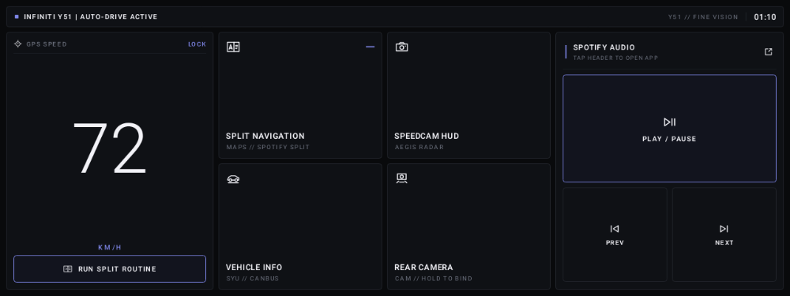
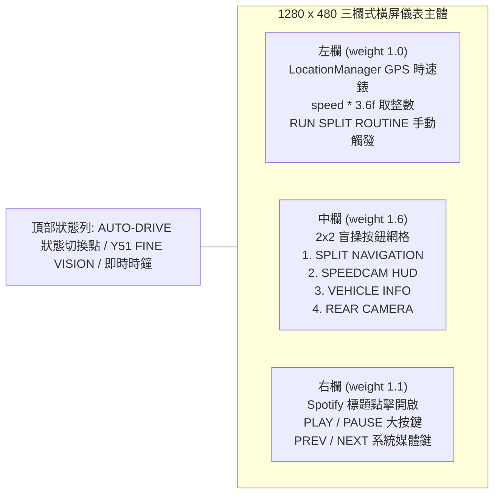

# infinitiX_CarLauncher (Y51 DriveOS)

專為 **Infiniti M25 (Y51)** 搭配 **方易通 FYT UIS7862 安卓車機（`1280 x 480` 8:3 超寬帶魚屏）** 打造的原生 Android (Kotlin) 車機桌面與零點擊行車自動化系統。

採用日系原廠高對比儀表美學（Infiniti Fine Vision 風格），以純原生 Android Views 建置，保持輕量體積與 Android 10（API 29）分屏及背景啟動相容性。

---

## 介面預覽 (1280 x 480 Fine Vision UI)

### 1. 行車啟動狀態（Auto-Drive 已啟用 & GPS 定位鎖定）


### 2. 待機／未啟用無障礙服務提示狀態


> [!NOTE]
> 以上截圖係透過 Android LayoutLib 以 `1280 x 480`、`160dpi`、`LANDSCAPE` 配置真實渲染專案版面資源所輸出之 `8:3` 比例預覽圖。

---

## 系統與硬體規格

| 項目 | 規格設定 |
| :--- | :--- |
| 目標車型／硬體 | Infiniti M25 Y51 / 方易通 FYT UIS7862 |
| 螢幕方向與比例 | 強制鎖定橫屏 (`landscape`)，專為 `1280 x 480` (8:3) 設計 |
| SDK 版本 | `minSdk = 26`、`targetSdk = 29`、`compileSdk = 34` |
| 套件 ID | `com.infiniti.m25launcher` |
| 技術架構 | Kotlin + Android Views (`LinearLayout` / `ConstraintLayout`)，無 Jetpack Compose |
| 建置工具 | Gradle 8.4 / Android Gradle Plugin 8.2.2 / Kotlin 1.9.22 |

---

## 視覺設計規範

為確保白天日照與夜間駕駛時的視覺專注度與清晰度，介面嚴格遵守以下儀表規範：

- **消光黑底與面板層次**：背景 `#090A0C`，功能面板 `#0F1115` 搭配 `1dp` `#22252C` 髮絲紋邊框與 `4dp` 銳利微圓角。
- **字體與配色**：主文字 `#F2F2F7`、次要標籤 `#6E7380`（全大寫並加寬 `letterSpacing`）、重點強調色 `#7D85E6`。
- **等寬數字防抖**：數位時速與右上角即時時間啟用 `tnum`（Tabular Numerals）避免車速跳動時數字左右位移。
- **純線性圖示**：所有圖示皆為自訂單色線性 `VectorDrawable`（`1.5dp` 描邊、`#F2F2F7`），不使用任何 Emoji、漸層發光陰影或大圓角卡片。

---

## 三欄式介面與功能架構



### 各模組功能說明

| 區域 | 元件 / 按鈕 | 對應行為與目標套件 |
| :--- | :--- | :--- |
| **頂部狀態列** | Auto-Drive 狀態指示 | 偵測 `AutoDriveService` 啟用狀態；未開啟時點擊直接跳轉 `Settings.ACTION_ACCESSIBILITY_SETTINGS` |
| **頂部狀態列** | 右側即時時鐘 | `TextClock` 自動同步系統 24 小時制時間（`HH:mm`） |
| **左欄** | GPS 數位時速錶 | 使用 `LocationManager.GPS_PROVIDER` 讀取 `speed * 3.6f` 取整數顯示，支援 `autoSizeTextType="uniform"` |
| **左欄** | `RUN SPLIT ROUTINE` | 手動觸發完整行車自動化流程（略過 5 分鐘冷卻限制） |
| **中欄 #1** | `SPLIT NAVIGATION` | 啟動 Google Maps 並由無障礙服務觸發左右分屏，並排啟動 Spotify |
| **中欄 #2** | `SPEEDCAM HUD` | 啟動神盾測速照相（`tw.com.aegis.speedcam`） |
| **中欄 #3** | `VEHICLE INFO` | 啟動方易通原車資訊（`com.syu.carinfo`，若未安裝則 fallback 至 `com.syu.canbus`） |
| **中欄 #4** | `REAR CAMERA` | 短按依序嘗試 `com.syu.avm` → `com.syu.frontview` → `com.syu.dvr` → `com.syu.fcam` → `com.syu.aux` → `com.syu.video`；**長按可開啟選單自訂綁定車機 App** |
| **右欄** | `SPOTIFY AUDIO` 標題 | 點擊開啟 Spotify（`com.spotify.music`） |
| **右欄** | `PLAY / PAUSE`、`PREV`、`NEXT` | 透過 `AudioManager.dispatchMediaKeyEvent` 發送 `ACTION_DOWN` + `ACTION_UP` 系統媒體按鍵 |

> [!IMPORTANT]
> **Infiniti M25 Y51 原廠倒車鏡頭硬體限制提醒**：原廠倒車鏡頭多半僅於打 R 檔時供電（由車機 MCU 底層自動切換倒車顯影）。若未額外將鏡頭改為 ACC 穩壓常電或加裝常電 AHD 鏡頭，於 P/D 檔手動開啟影像通道仍會顯示無訊號；`REAR CAMERA` 按鈕支援長按自訂目標套件，方便對應不同版本的 FYT 韌體或外接鏡頭應用。

---

## 零點擊行車管家 (`AutoDriveService`) 自動化流程

`AutoDriveService` 繼承自 `AccessibilityService`，於綁定後動態註冊 `BroadcastReceiver` 監聽車機喚醒廣播 `Intent.ACTION_SCREEN_ON` 與 `Intent.ACTION_USER_PRESENT`。

```mermaid
sequenceDiagram
    participant SYS as 車機系統廣播
    participant ADS as AutoDriveService
    participant APP as 目標應用程式
    participant AUD as AudioManager

    SYS->>ADS: ACTION_SCREEN_ON / ACTION_USER_PRESENT
    ADS->>ADS: 檢查 SystemClock.elapsedRealtime() 5 分鐘冷卻
    Note over ADS: 採用單調開機時鐘，避免 GPS/NTP 校時造成冷卻誤判

    rect rgb(15, 17, 21)
        ADS->>APP: 0.5s - 啟動神盾測速 (tw.com.aegis.speedcam)
        ADS->>APP: 2.5s - 啟動 Google Maps (com.google.android.apps.maps)
        ADS->>SYS: 3.7s (+1.2s) - performGlobalAction(TOGGLE_SPLIT_SCREEN)
        ADS->>APP: 4.4s (+0.7s) - FLAG_ACTIVITY_LAUNCH_ADJACENT 啟動 Spotify
        ADS->>AUD: 5.5s - dispatchMediaKeyEvent(KEYCODE_MEDIA_PLAY)
    end
```



---

## 專案目錄結構

```text
infinitiX_CarLauncher/
├── app/
│   ├── build.gradle                              # compileSdk 34 / minSdk 26 / targetSdk 29
│   └── src/
│       ├── main/
│       │   ├── AndroidManifest.xml               # HOME Launcher 註冊與 AutoDriveService 宣告
│       │   ├── java/com/infiniti/m25launcher/
│       │   │   ├── MainActivity.kt               # 三欄儀表主畫面、GPS 時速、沉浸式與長按綁定選單
│       │   │   ├── AutoDriveService.kt           # 喚醒廣播監聽、5 分鐘冷卻與分屏排程服務
│       │   │   └── AppLauncher.kt                # 套件備援啟動、媒體鍵發送、無障礙狀態檢查
│       │   └── res/
│       │       ├── drawable/                     # 4dp 微圓角面板樣式與 1.5dp 單色線性圖示
│       │       ├── layout/
│       │       │   ├── activity_main.xml         # 1280x480 三欄式橫屏主佈局
│       │       │   ├── dialog_app_picker.xml     # Fine Vision 深色 App 綁定視窗
│       │       │   └── item_app_picker.xml       # App 清單列項目
│       │       ├── values/                       # Fine Vision 色票、字串與無標題全螢幕主題
│       │       └── xml/
│       │           └── accessibility_service_config.xml
│       └── test/java/com/infiniti/m25launcher/
│           └── AutoDriveLogicTest.kt             # 時速換算、冷卻時間、備援解析與排序單元測試
├── docs/
│   ├── ui_preview_active.png                     # 行車啟動狀態渲染截圖
│   └── ui_preview_inactive.png                   # 待機狀態渲染截圖
├── build.gradle
├── settings.gradle
├── gradle.properties
├── git.md                                        # Git 提交、標籤發版與忽略規則指引
└── .gitignore
```

---

## 編譯與車機部署指南

### 1. 本機編譯 Debug APK 與執行測試

```powershell
.\gradlew.bat assembleDebug testDebugUnitTest
```

編譯完成後的 APK 位於：
`app/build/outputs/apk/debug/app-debug.apk`

### 2. 透過 ADB 安裝至 FYT UIS7862 車機

```powershell
adb install -r app\build\outputs\apk\debug\app-debug.apk
```

### 3. 車機端初次啟用設定

1. **設為預設車機桌面**：安裝後按車機實體 `HOME` 鍵，選擇 `Y51 DriveOS` 並設為「一律採用」。
2. **授與精準定位權限**：首次啟動允許定位權限，左欄 GPS 數位時速錶即可即時顯示車速。
3. **啟用無障礙自動管家**：點擊頂部 `INFINITI Y51 | AUTO-DRIVE OFF - TAP TO ENABLE` 跳轉系統無障礙設定，開啟 `Y51 Auto-Drive Service`。
4. **（選用）自訂後鏡頭套件**：長按中欄右下角 `REAR CAMERA` 卡片，可從車機已安裝清單指定對應的鏡頭或影像 App。

---

## Git 協作與發版流程

專案之 `.gitignore` 設定、Conventional Commits 規範與標籤發版指令，請參閱 [git.md](git.md)。
