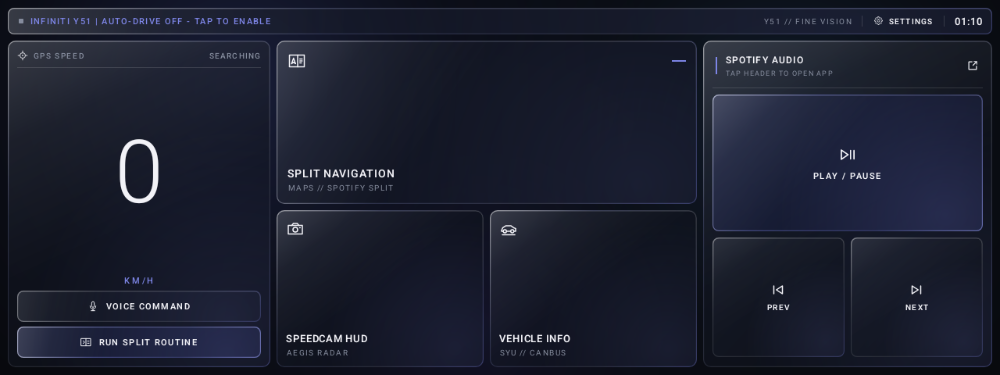
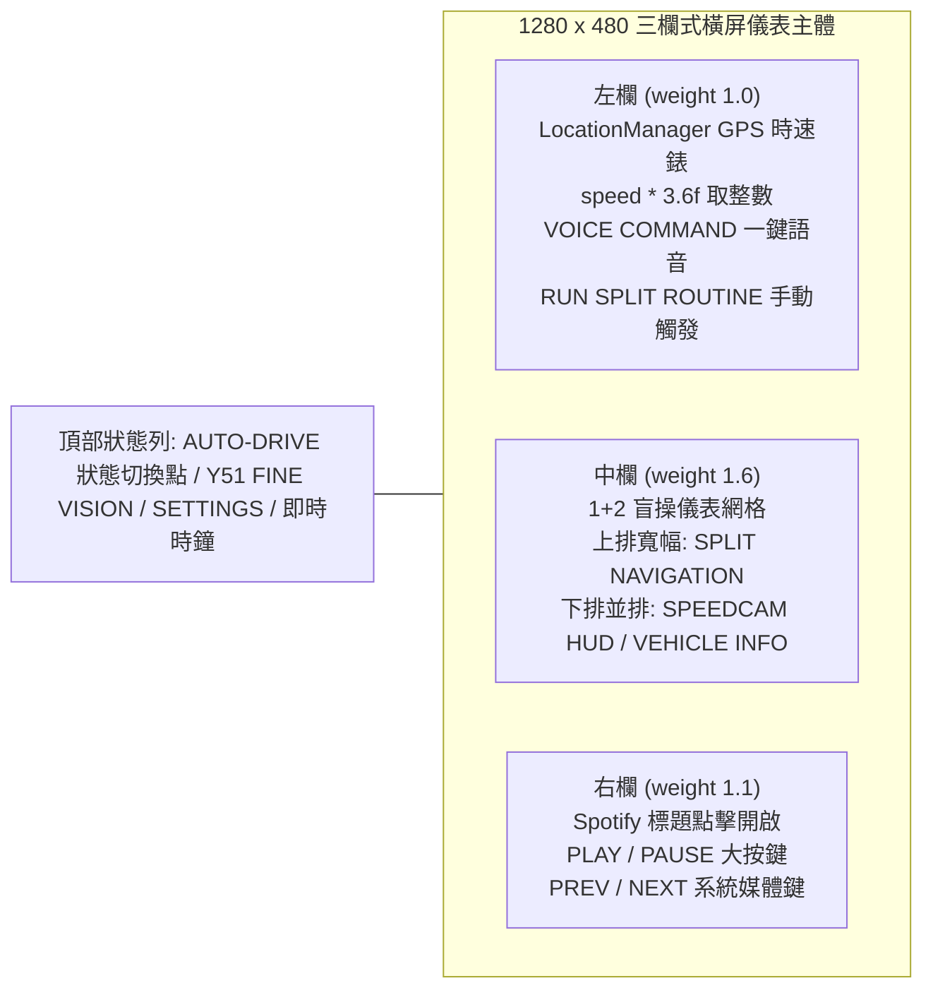

# infinitiX_CarLauncher (Y51 DriveOS)

專為 **Infiniti M25 (Y51)** 搭配 **方易通 FYT UIS7862 安卓車機（`1280 x 480` 8:3 超寬帶魚屏）** 打造的原生 Android (Kotlin) 車機桌面與零點擊行車自動化系統。

採用日系原廠高對比儀表美學（Infiniti Fine Vision 風格）與低眩光深色液態玻璃（Liquid Glass）質感，以純原生 Android Views 建置，保持輕量體積與 Android 10（API 29）分屏及背景啟動相容性。

---

## 介面預覽 (1280 x 480 Fine Vision Liquid Glass UI)

### 1. 行車啟動狀態（Auto-Drive 已啟用 & GPS 定位鎖定）


### 2. 待機／未啟用無障礙服務提示狀態


> [!NOTE]
> 以上截圖係透過 Android LayoutLib 以 `1280 x 480`、`160dpi`、`LANDSCAPE` 配置真實渲染專案版面與 `LiquidGlassDrawable` 效果所輸出之 `8:3` 比例預覽圖。

---

## 系統與硬體規格

| 項目 | 規格設定 |
| :--- | :--- |
| 目標車型／硬體 | Infiniti M25 Y51 / 方易通 FYT UIS7862 |
| 螢幕方向與比例 | 強制鎖定橫屏 (`landscape`)，專為 `1280 x 480` (8:3) 設計 |
| SDK 版本 | `minSdk = 26`、`targetSdk = 29`、`compileSdk = 34` |
| 套件 ID | `com.infiniti.m25launcher` |
| 技術架構 | Kotlin + Android Views (`LinearLayout` / `ConstraintLayout`)，無 Jetpack Compose |
| 建置工具 | Gradle 8.4 / Android Gradle Plugin 8.2.2 / Kotlin 1.9.22 |

---

## 視覺設計規範（Fine Vision Liquid Glass）

為確保白天日照與夜間駕駛時的視覺專注度與清晰度，介面結合 Infiniti Fine Vision 儀表美學與低眩光深色液態玻璃質感：

- **深邃微光底層 (`DashboardBackdropDrawable`)**：以 `#07080B` 消光黑為基底，疊加低亮度靛藍與冷藍柔光光暈，提供玻璃卡片所需的自然透射層次且夜間不刺眼。
- **多層液態玻璃卡片 (`LiquidGlassDrawable`)**：支援 API 26+ 硬體加速渲染，整合半透明煙燻玻璃本體、左上高光反射帶、內緣厚度倒角與方向性漸層折射邊框（`10dp` / `8dp` 微圓角），按壓時即時強化邊框與折射高光回饋。
- **字體與配色**：主文字 `#F2F2F7`、次要標籤 `#858C9D`（全大寫並加寬 `letterSpacing`）、重點強調色 `#7D85E6`。
- **等寬數字防抖**：數位時速與右上角即時時間啟用 `tnum`（Tabular Numerals）避免車速跳動時數字左右位移。
- **純線性圖示**：所有圖示皆為自訂單色線性 `VectorDrawable`（`1.5dp` 描邊、`#F2F2F7`），不使用任何 Emoji。

---

## 三欄式介面與功能架構



### 各模組功能說明

| 區域 | 元件 / 按鈕 | 對應行為與目標套件 |
| :--- | :--- | :--- |
| **頂部狀態列** | Infiniti 銘牌與系統狀態體檢 | 嵌入 Infiniti Y51 幾何雙拱銘牌與綠/紫/橘狀態燈；**點擊彈出「系統狀態體檢面板」**（免 ADB 一鍵檢查預設桌面、無障礙、封面同步、定位/麥克風、背景省電白名單，並顯示 `v1.2` 版本號） |
| **頂部狀態列** | `APPS` 應用抽屜 | **短按直開「全部應用程式抽屜」**（4 欄液態玻璃清單，**長按任意 App 圖示即可釘選至最愛首排**） |
| **頂部狀態列** | `設定` 齒輪鍵 | 一鍵跳轉 Android 系統設定（`Settings.ACTION_SETTINGS`），快速管理 Wi-Fi、藍牙與預設桌面 |
| **頂部狀態列** | 日期星期與即時時鐘 | `TextClock` 自動同步日期星期（`MM.dd EEE`）與 24 小時制等寬時間（`HH:mm`） |
| **左欄** | Fine Vision 雙環精密時速錶 | 240° 精密刻度光弧、`ValueAnimator` 絲滑數字滾動、八方位羅盤航向（`NE 042°`）、`>= 115 km/h` 琥珀微光警示與 `MAX / AVG / TIME` 單趟數據（長按 `GPS 時速` 歸零） |
| **左欄** | `語音指令` / `一鍵出發` | 短按開啟語音路由器（**長按編輯「回家 / 去公司」地址**）；`一鍵出發` 略過冷卻啟動完整行車排程 |
| **中欄上排** | `分屏導航` (`50:50 SPLIT`) | 內含工藝幾何浮水印與物理阻尼微縮放，啟動 Google Maps 並由無障礙服務觸發左 Maps + 右 Spotify 分屏 |
| **中欄下左** | `神盾測速` (`AEGIS RADAR`) | 啟動神盾測速照相（`tw.com.ainvest.outpack`，備援 `tw.com.aegis.speedcam` 與「神盾」標籤搜尋） |
| **中欄下右** | `原車資訊` (`SYU · CANBUS`) | 啟動方易通原車資訊（`com.syu.carinfo`，若未安裝則 fallback 至 `com.syu.canbus`） |
| **右欄** | 專輯封面氛圍玻璃與時間碼 | 同步 Spotify 真實專輯封面縮圖、低亮度氛圍玻璃底色與色調折射，搭配光學進度條與等寬時間碼（`01:24 / 03:58`）；短按開啟 Spotify，**長按開通知存取** |
| **右欄** | `PLAY / PAUSE`、`PREV`、`NEXT` | 具 `97%` 按壓微縮放與觸覺回饋，透過 `AudioManager.dispatchMediaKeyEvent` 控制播放並同步切換圖示 |

---

## 零點擊行車管家 (`AutoDriveService`) 自動化流程

`AutoDriveService` 繼承自 `AccessibilityService`，於綁定後動態註冊 `BroadcastReceiver` 監聽車機喚醒與熄火廣播（`ACTION_SCREEN_ON`、`ACTION_USER_PRESENT`、`ACTION_SCREEN_OFF`）：

- **分屏狀態列自動收縮**：進入 Maps + Spotify 分屏時，若已透過 ADB 授予 `WRITE_SECURE_SETTINGS`，自動套用套件限定 `Settings.Global.policy_control = immersive.status=com.google.android.apps.maps,com.spotify.music`，返回桌面或螢幕關閉時自動清除還原。
- **ACC 熄火 / 關屏記憶體釋放**：收到 `Intent.ACTION_SCREEN_OFF` 時立即取消未完成排程、發送 `KEYCODE_MEDIA_PAUSE` 暫停音樂、切回 `MainActivity` 停止前景渲染，並於 750ms 後對非系統之第三方應用呼叫 `ActivityManager.killBackgroundProcesses()`（完整保留 `com.syu.*`、`com.fyt.*`、GMS、Google 語音與輸入法；原生 Android 10 安全機制下，非 root/system 應用無法對其他 App 執行強制 `force-stop`）。

```mermaid
sequenceDiagram
    participant SYS as 車機系統廣播
    participant ADS as AutoDriveService
    participant APP as 目標應用程式
    participant AUD as AudioManager

    SYS->>ADS: ACTION_SCREEN_ON / ACTION_USER_PRESENT
    ADS->>ADS: 檢查 SystemClock.elapsedRealtime() 5 分鐘冷卻
    Note over ADS: 採用單調開機時鐘，避免 GPS/NTP 校時造成冷卻誤判

    rect rgb(15, 17, 21)
        ADS->>APP: 0.5s - 啟動神盾測速 (tw.com.ainvest.outpack)
        ADS->>APP: 2.2s - 預熱 Spotify 進入最近任務第一位
        ADS->>APP: 3.1s - 啟動 Google Maps (com.google.android.apps.maps)
        ADS->>SYS: 4.3s - performGlobalAction(TOGGLE_SPLIT_SCREEN)
        ADS->>APP: 5.1s - 點擊右側最近任務 Spotify 卡片 (或 ADJACENT+MULTIPLE_TASK 備援)
        ADS->>AUD: 6.8s - dispatchMediaKeyEvent(KEYCODE_MEDIA_PLAY)
    end
```



---

## 車機語音路由器 (`VoiceTriggerActivity` / `VoiceCommandRouter`)

利用車機內建 Google 語音引擎（`SpeechRecognizer`、`zh-TW`），提供駕駛專用的輕量指令路由懸浮視窗：

- **四種喚醒與配對機制（支援行車中於任何 App 上層喚醒）**：
  1. 點擊桌面左欄 `VOICE COMMAND` 按鈕。
  2. 透過 `AutoDriveService.onKeyEvent()` 攔截系統語音鍵（`KEYCODE_VOICE_ASSIST` / `KEYCODE_ASSIST` / `KEYCODE_SEARCH`）或使用者自訂綁定的方控按鍵碼。
  3. **HUD 一鍵學習方控鍵（`BIND SWC KEY`）**：點擊語音視窗上方 `BIND SWC KEY`，於 12 秒內按下車機方向盤實體語音鍵即可儲存對應 `KeyCode`（需先啟用無障礙服務；系統僅保護 `Back`/`Home`/音量鍵）。
  4. 於方易通「方控學習」將語音鍵直接綁定啟動 **`Y51 Voice`**（`CATEGORY_LAUNCHER`），或系統 `ACTION_ASSIST` / `ACTION_VOICE_COMMAND` / `SEARCH_LONG_PRESS`。
- **語音引擎雙重備援與錯誤診斷**：若車機內嵌 Google `SpeechRecognizer` 回報 `ERROR_CLIENT` / `ERROR_AUDIO` / `ERROR_SERVER`，將自動顯示錯誤碼並轉由系統 Google 語音彈窗（`RecognizerIntent.ACTION_RECOGNIZE_SPEECH`）接手辨識；長按 `GOOGLE ASSISTANT` 可開啟系統語音輸入設定。
- **音樂閃避降音**：收音時申請 `AUDIOFOCUS_GAIN_TRANSIENT_MAY_DUCK` 降低背景音樂音量，辨識結束立即恢復。

| 口語指令範例 | 解析動作 (`VoiceAction`) | 執行行為 |
| :--- | :--- | :--- |
| 「回家」/「導航回家」/「去公司」/「導航到公司」 | `NavigateHome` / `NavigateWork` | 讀取已儲存的住家／公司地址並自動進入左 Maps + 右 Spotify 導航分屏 |
| 「導航到台北101」/「帶我去桃園機場」 | `NavigateSplit` | 啟動 Google Maps 導航並自動維持或進入左 Maps + 右 Spotify 分屏 |
| 「播放周杰倫」/「我想聽告五人」 | `PlaySpotifySearch` | 透過 `MEDIA_PLAY_FROM_SEARCH` 直接送給 Spotify 搜尋開播 |
| 「下一首」/「上一首」/「暫停」/「繼續播放」 | `MediaControl` | 發送系統媒體按鍵（`KEYCODE_MEDIA_*`） |
| 「分屏導航」/「一鍵出發」 | `StartSplitNavigation` / `StartAutoDriveRoutine` | 直接觸發分屏或完整 Auto-Drive 排程 |
| 「打開神盾」/「原車資訊」/「回桌面」 | `LaunchSpeedcam` / `LaunchVehicleInfo` / `GoHome` | 切換指定車機應用或返回桌面 |
| 「大聲一點」/「聲音小一點」/「靜音」 | `VolumeControl` | 調整 `STREAM_MUSIC` 音量或靜音切換 |
| 未匹配指令 / 一般查詢 | `FallbackAssistant` | 保留結果並提供一鍵轉交 Google 語音助理 (`GOOGLE ASSISTANT`) |

---

## 專案目錄結構

```text
infinitiX_CarLauncher/
├── app/
│   ├── build.gradle                              # compileSdk 34 / minSdk 26 / targetSdk 29
│   └── src/
│       ├── main/
│       │   ├── AndroidManifest.xml               # HOME Launcher 註冊與 AutoDriveService 宣告
│       │   ├── java/com/infiniti/m25launcher/
│       │   │   ├── MainActivity.kt               # 三欄儀表主畫面、雙環時速錶、專輯氛圍媒體、體檢與抽屜彈窗
│       │   │   ├── FineVisionSpeedGaugeView.kt   # 240° Fine Vision 精密雙環刻度光弧與阻尼動畫元件
│       │   │   ├── TactileFeedbackHelper.kt      # 全介面車規 97% 物理按壓微縮放與觸覺回饋
│       │   │   ├── CockpitThemeMode.kt           # 日間抗反光 / 夜間低眩光時段自動切換判斷
│       │   │   ├── SystemHealthHelper.kt         # 免 ADB 五項車機權限/省電白名單檢測與一鍵導向
│       │   │   ├── PinnedAppsStore.kt            # 應用程式抽屜長按釘選最愛首排儲存與排序
│       │   │   ├── TripTelemetryTracker.kt       # GPS 去雜訊、八方位羅盤、超速警示與單趟統計
│       │   │   ├── MediaNotificationService.kt   # 系統通知監聽錨點服務（供 MediaSession 存取）
│       │   │   ├── MediaSessionMonitor.kt        # Spotify 曲目、專輯封面、氛圍主色萃取與時間碼同步
│       │   │   ├── SavedPlacesStore.kt           # 語音「回家 / 去公司」地址本地儲存
│       │   │   ├── SwcKeyStore.kt                # 方向盤自訂語音方控 KeyCode 本地儲存與系統鍵保護
│       │   │   ├── VoiceTriggerActivity.kt       # 液態玻璃語音收音懸浮介面、方控綁定與彈窗備援
│       │   │   ├── VoiceCommandRouter.kt         # 中英口語指令解析與分屏/導航/媒體路由
│       │   │   ├── AutoDriveService.kt           # 喚醒/熄火廣播監聽、方控攔截與分屏排程服務
│       │   │   ├── AppLauncher.kt                # 套件備援啟動、全部 App 查詢、媒體鍵發送與全螢幕控制
│       │   │   ├── DashboardBackdropDrawable.kt  # 低眩光環境光暈底層（提供玻璃折射背景）
│       │   │   ├── LiquidGlassDrawable.kt        # API 26+ 多層液態玻璃與漸層邊框 Drawable
│       │   │   └── LiquidGlassStyler.kt          # 儀表卡片、語音 HUD 與抽屜彈窗玻璃樣式套用器
│       │   └── res/
│       │       ├── drawable/                     # 面板預設背景與 1.5dp 單色線性圖示
│       │       ├── layout/
│       │       │   ├── activity_main.xml         # 1280x480 三欄式橫屏主佈局
│       │       │   └── activity_voice_overlay.xml # 語音路由器懸浮視窗佈局
│       │       ├── values/                       # Fine Vision 色票、字串與無標題/半透明主題
│       │       └── xml/
│       │           └── accessibility_service_config.xml
│       └── test/java/com/infiniti/m25launcher/
│           ├── AutoDriveLogicTest.kt             # 時速換算、冷卻時間、備援解析與玻璃狀態測試
│           └── VoiceCommandRouterTest.kt         # 語音導航、Spotify 搜尋、媒體與音量解析測試
├── docs/
│   ├── ui_preview_active.png                     # 行車啟動狀態渲染截圖
│   └── ui_preview_inactive.png                   # 待機狀態渲染截圖
├── build.gradle
├── settings.gradle
├── gradle.properties
├── git.md                                        # Git 提交、標籤發版與忽略規則指引
└── .gitignore
```

---

## 編譯與車機部署指南

### 1. 本機編譯 Debug APK 與執行測試

```powershell
.\gradlew.bat assembleDebug testDebugUnitTest
```

編譯完成後的 APK 位於：
`app/build/outputs/apk/debug/app-debug.apk`

### 2. 透過 ADB 安裝至 FYT UIS7862 車機

```powershell
adb install -r app\build\outputs\apk\debug\app-debug.apk
```

### 3. 車機端初次啟用設定（支援純 APK 安裝、免 ADB）

1. **安裝 APK（無需電腦 / ADB）**：將 `app-debug.apk` 透過隨身碟或 Google Drive 下載至車機直接安裝；可於抽屜或系統體檢面板右上角確認版本號（`v1.2 · 2026.11.26`）。
2. **一鍵完成全部授權**：點擊頂部左上角 **Infiniti 狀態列** 開啟「**系統狀態體檢面板**」，依序點擊橘燈項目即可完成 5 項授權（預設桌面、無障礙管家、Spotify 封面同步、定位/麥克風、背景省電白名單），全部亮綠燈即完成。
3. **設定方向盤方控語音鍵**：打開語音介面點擊 `綁定方控鍵` 後於 12 秒內按方向盤按鍵配對；若車機方控晶片未上報標準 Android `KeyEvent`，請改於方易通「方控學習」將該按鍵直接綁定啟動 **`Y51 Voice`**。
4. **（選用／僅有 ADB 環境時）分屏狀態列自動隱藏**：若日後有連接電腦 ADB，可執行一次 `adb shell pm grant com.infiniti.m25launcher android.permission.WRITE_SECURE_SETTINGS`；無 ADB 時亦可於車機「工廠設定 → 顯示 / UI 設定」查看是否內建隱藏狀態列選項。

---

## Git 協作與發版流程

專案之 `.gitignore` 設定、Conventional Commits 規範與標籤發版指令，請參閱 [git.md](git.md)。
